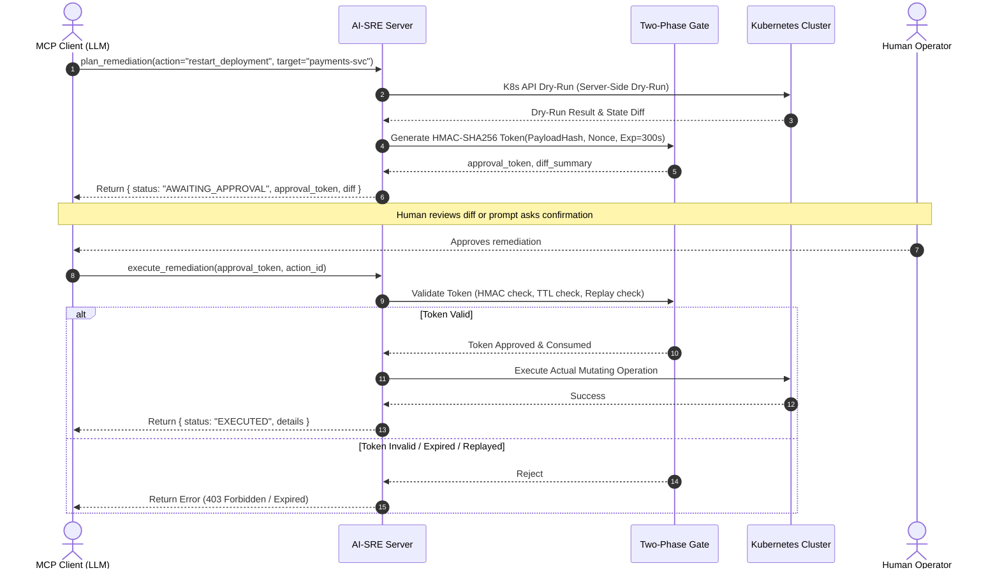

# AI-SRE Cluster Manager: Architectural Specification & Security Model

## 1. Executive Summary & Core Tenets

The **AI-SRE Cluster Manager** is an enterprise-grade, fintech-compliant Model Context Protocol (MCP) server. It enables Large Language Model (LLM) agents to observe, diagnose, and remediate Kubernetes cluster anomalies under strict Zero-Trust and zero-data-leakage constraints.

### Guiding Principles
1. **Zero-Trust Autonomous Boundary:** LLMs cannot execute mutating operations directly. All mutating commands require a Two-Phase Cryptographic Capability Gate.
2. **Zero-Egress Data Sanitization:** Kubernetes pod logs, events, and metrics are scrubbed of high-entropy secrets and irreversible salted-tokenized for PII before leaving the host or entering local vector indices.
3. **Local-First Knowledge Retrieval:** All runbooks, post-mortems, and topologies are indexed in an embedded LanceDB vector database using local ONNX embeddings (`fastembed`). Zero third-party API dependencies.
4. **Deterministic Auditability:** Every tool invocation, sanitization event, and cluster action is instrumented with OpenTelemetry (OTel) traces and written to an append-only audit trail.

---

## 2. System Architecture (C4 Container View)

```mermaid
flowchart TD
    subgraph ClientLayer ["Client / Agent Host Layer"]
        Host["MCP Client (Claude Desktop / Cursor / IDE)"]
    end

    subgraph MCPServer ["AI-SRE MCP Server (Python 3.12 / uv)"]
        Router["FastMCP Protocol Router & Dispatcher"]
        
        subgraph Guardrails ["Fintech Guardrail Engine"]
            SecretScanner["High-Entropy Secret Redactor"]
            PIITokenizer["Irreversible Salted PII Tokenizer"]
        end

        subgraph SecurityGate ["Two-Phase Execution Gate"]
            TokenManager["HMAC-SHA256 Capability Token Signer"]
            DryRunDiff["K8s Dry-Run & Diff Generator"]
        end

        subgraph RAGPipeline ["Local Runbook RAG Engine"]
            Embedder["FastEmbed (all-MiniLM-L6-v2)"]
            VectorStore["Embedded LanceDB (Parquet)"]
        end

        subgraph K8sAdapter ["Kubernetes AsyncIO Driver"]
            K8sClient["kubernetes_asyncio API Client"]
            K8sCluster[("Target Cluster / Minikube")]
        end

        subgraph Observability ["Telemetry & Audit Plane"]
            OTel["OpenTelemetry Tracer & Meter"]
            AuditLog[("Local Audit Log (JSONL)")]
        end
    end

    Host <==>|JSON-RPC 2.0 (stdio / SSE)| Router
    Router -->|1. Sanitize Ingress/Egress| Guardrails
    Router -->|2. Semantic Search| RAGPipeline
    Router -->|3. Mutation Prep (Dry-Run)| SecurityGate
    Router -->|4. Authenticated Exec| K8sAdapter
    Router -->|5. Traces & Metrics| Observability
    K8sAdapter <==>|TLS / Kubeconfig| K8sCluster
    RAGPipeline <==>|Direct IO| VectorStore
```

---

## 3. Threat Model & Mitigations (Fintech Standard)

| Threat ID | Threat Vector | Impact | Architectural Mitigation |
| :--- | :--- | :--- | :--- |
| **TM-01** | LLM Prompt Injection / Jailbreak | Agent commands cluster destruction (`kubectl delete ns production`). | **Two-Phase Execution Gate**: Write operations require a dry-run confirmation token with a 300s TTL. |
| **TM-02** | Credential Leakage in Pod Logs | AWS Keys, JWTs, or passwords in stdout leak into LLM context / training data. | **Dual-Stage Regex Sanitizer**: Redacts secrets to `[REDACTED_<TYPE>]` before returning data or vectorizing. |
| **TM-03** | PII / PCI-DSS Violation | Customer Account Numbers / PANs indexed or surfaced during incident triage. | **Deterministic Salted Tokenization**: Cleartext PII is transformed into `[TOKEN:sha256(salt + pii)[:8]]` allowing correlation without cleartext exposure. |
| **TM-04** | Execution Replay Attack | Stale or intercepted dry-run token replayed by malicious actor. | **Single-Use HMAC Tokens with Nonce**: Tokens expire after TTL and are invalidated immediately upon first execution attempt. |
| **TM-05** | Airgap / Network Partition Outage | External embedding API failure disables SRE diagnostics during a critical outage. | **Local Embedded RAG**: Zero external network egress; embeddings generated locally via CPU ONNX models. |

---

## 4. Two-Phase Execution Gate (State Machine)



---

## 5. Tool Catalog (Contract Specifications)

### A. Observability & Query Tools (Read-Only)
1. **`cluster_get_overview`**: Returns node health, namespace summary, resource saturation (CPU/Memory).
2. **`cluster_get_pod_logs`**: Streams sanitized, redacted logs for specified pods with tail and timestamp filters.
3. **`cluster_get_events`**: Fetches Kubernetes warning/error events for a specific namespace or workload.

### B. Local RAG Tools (Read-Only)
4. **`rag_search_runbooks`**: Performs semantic search across local SRE runbooks, post-mortems, and architecture docs.
5. **`rag_index_document`**: Indexes new runbook markdown or post-mortem incident report into local LanceDB.

### C. Remediation Tools (Mutating / Two-Phase Gate)
6. **`cluster_plan_remediation`**: Executes a server-side dry run, constructs a unified diff, and mints an HMAC approval token.
7. **`cluster_execute_remediation`**: Consumes an approval token, performs cryptographic validation, and executes the mutation.

---

## 6. Directory Structure & File Roadmap

```
ai-sre-mcp/
├── .python-version
├── pyproject.toml               # uv project configuration & dependencies
├── DESIGN.md                    # This architecture specification
├── src/
│   └── ai_sre/
│       ├── __init__.py
│       ├── server.py            # FastMCP Server entrypoint & lifecycle
│       ├── config.py            # Pydantic v2 application settings
│       ├── schemas/             # Pydantic v2 input/output tool schemas
│       │   ├── __init__.py
│       │   ├── cluster.py
│       │   ├── remediation.py
│       │   └── rag.py
│       ├── guardrails/          # Level B PII & Secret Redaction
│       │   ├── __init__.py
│       │   ├── redactor.py      # High-entropy regex redactor
│       │   └── tokenizer.py     # Deterministic salted PII hash tokenizer
│       ├── security/            # Two-Phase Execution Gate
│       │   ├── __init__.py
│       │   └── approval_gate.py # HMAC token minting, verification & replay cache
│       ├── rag/                 # Embedded LanceDB & fastembed pipeline
│       │   ├── __init__.py
│       │   ├── vector_store.py  # LanceDB interface
│       │   └── embeddings.py    # Local ONNX CPU embedder
│       ├── k8s/                 # Kubernetes AsyncIO Client Adapter
│       │   ├── __init__.py
│       │   └── client.py        # K8s async operations with dry-run support
│       └── telemetry/           # OpenTelemetry & Audit Logging
│           ├── __init__.py
│           ├── tracer.py        # OTel trace provider & span helpers
│           └── audit.py         # Append-only structured JSONL audit logger
└── tests/                       # Pytest suite with strict mock coverage
    ├── test_guardrails.py
    ├── test_approval_gate.py
    ├── test_k8s_client.py
    └── test_rag.py
```

